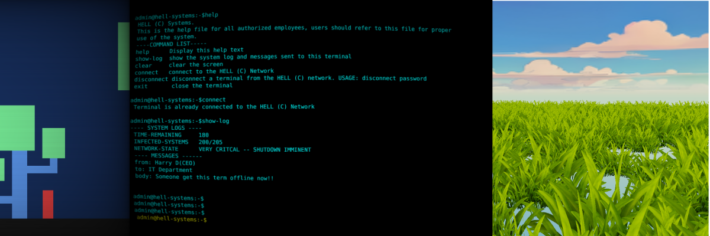
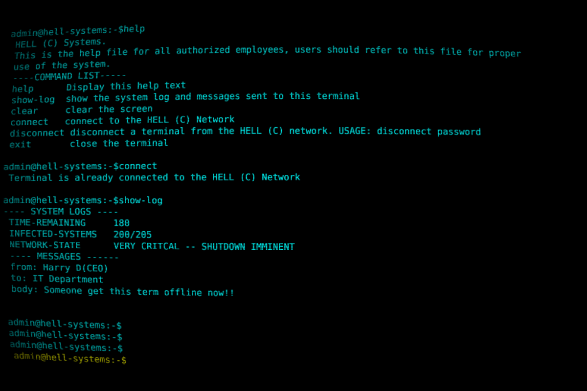
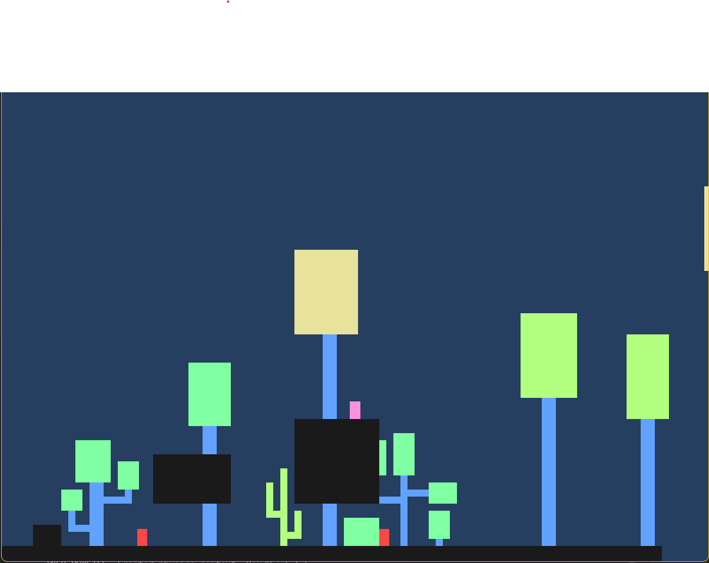

2026 definitely gotta be the most chaotic year already, so I wanna use dis post to just show off 🥲 my failed projects.
And it also helps with generally just posting sometin cool anyways

So like every normal or unnormal person I had some pretty neat goals for dis year with regards to my game dev life. And so so many "cool" and "fun ideas" swimming around in my head.

# Starting the year first project
## *Saint.joe.*
put st.joe screen shot here

So one semi random day in late january after I had settled down and adjusted to the semesters schedule, I saw the light, a vision, and it was something cool, a game idea. 
It was about a ghost, a colourful one, killing other colourful ghosts and I imagined this cool scene of ghost blood splattered everywhere on the walls, floor, ceiling and all those cool stuffs.
That was enough for me to jump on my laptop and start a new Love2d project, no game design document or anything, I just jumped into it.

**Fuckery #1**: who the fuc does that, no plan, no design just me launching myself into someting, I think I was probably like "what could go wrong". And this is a pretty reoccuring theme in all my stuffs.

Well on the good side it took me less dat 24 hours to have a pretty cool moving ghostty character, well dat was the end the rest was weeks of feature creep and stumbling in the light and darkness alike.
[insert some cool saint joe screenshots]

Well then tests came and exam came and went, blah blah blah boring and interesting life stuffs.
Then in May I had just started internship as a mobile app developer, and adjusting and learning the ropes of dart and flutter and all those things you gotta do as an intern 🥲.

Then in a routine doom scrolling session on Youtube like we all cool people do and I saw a video for annnouncing the game dev.tv game jam, yup I joined you know dudes be like what could go wrong I can handle, flutter and a game jam.

## *Hell Admin*

Well the jam started, and before I continue it has been one of the best or If not the best game jam experience I have ever had.
Before this jam I had just started to look and play around the defold game engine(cool engine by the way). So I decided to use Defold for the jam.

### What I think I did right dis time
I actually did some brainstorming for this game, and even the brain storming sessions were very fun.

So with the **theme** been **Connection**, I settled for this idea where you play as a Network engineer working in a seemingly shady company. Your goal is to disconnect a rogue computer terminal from the company's network while attempting to minimize the damage the rogue terminal will/can do.

Because the terminal can kill any number of nodes in the network depending on how well you play. In a nutshell it was kinda a game with multiple endings depending on how you relate with the terminal with an occasional mini game thrown in between as challenge from the terminal.

With the idea down I got workin on it, though progress was verrrrrrrrry sluggish, cos I was interning as well.

But for the little time I spent building the game bit by bit by hand the experience was very very thrilling and really fuking sweet.

And infact it urged me to create this is blog and here we are today. Well to close off I did not finish the game. But It was a cool experience never the less

### What went wrong on this one:
Guess I overestimated my self on how many work load I could put on my head, hence I was not able to complete the game. And maybe I got over ambitous even, cos to be frank I have not even written a story before lol, and here I was trynna nail down a story with branching dialogue.

## *Packet guys*

Remember I mentioned an occasional mini game for the previous project, I decided to turn it into its own game. And yep it did not end well either :(.

As a mini game it was supposed to be a packet chasing game. In which you chase some cool and maybe unfortunate little guys called packets which you then consume. It also includes some other guys called slides dat you should avoid as they corrupt your data.

Well I spent several weeks doing **"development"**, which was actually me thinking and trying to add more stuffs and cool visual effects. Well after a while development got stale and so went the game, and yup it went on the shelf.

## *Yet another grass*

Fortunately was not a game, just some codin adventure type stuff. Just an attempt at trying to render a large field of grass. And it was more like a learnin experience.

## *I Am His Mom*
Probably one of my sweetest projects this year.

So after a some time without working on any game project I was like okay I am gonna make a game, a complete game, a game to combat my perfectionism I said. A simple game, beautiful maybe, inspired by **Thomas Was Alone** and **Gris**.

A quite funny game about an angry mom trying to save her son from bullies, with some touch of mommy anger.

So after some usuall thinking and more thinking about stuffs like art style, code structure/project organisation, and how I will create levels etc, I set about making the game.

>*Hey but Miracle it seems you don’t have any game design or whatsoever*

Yep right you are I had no game design or someting to guide me. Literally what I had in my head was more of a visual aesthetic.

And thus I learnt someting pretty important from this project, I have never thought about game design, I know I am using the term broadly here, but I never had things like rules, why A behaves like A and why B is B, you know things like that, goals for the player etc.
